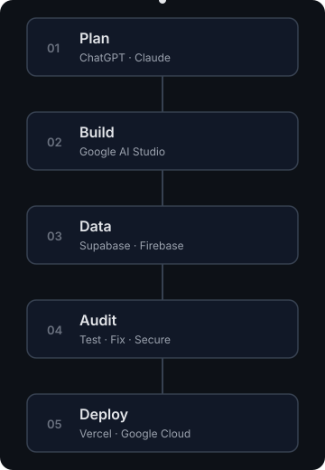

<div align="center">




[About](#about) · [Projects](#projects) · [Stack](#tools-i-work-with) · [Activity](#activity) · [Connect](#connect)

</div>

## About

I'm the founder of **ZPRIA**, a software company in Bangladesh. I'm not a traditional programmer. I build and ship real websites, web apps, online stores and automation by working with AI tools, and I take each product from idea to a live deployment.

I decide what gets built, how it's structured and how it should look. AI writes the code, then I test, audit and fix it before it goes live.

## What I Do

- Websites and landing pages
- E-commerce platforms and admin panels
- Web apps with authentication, databases and APIs
- Applications, browser extensions and Windows apps
- File management systems and digital books
- AI-powered tools and chat systems
- Workflow automation
- Facebook Ads and e-commerce marketing

## Now

- Building and shipping products under **ZPRIA**
- 20 projects in development, locked until launch (see Private Projects)
- Open to collaboration: [email me](mailto:iftekharibnasifat@gmail.com)

---

## Projects

[](https://voicetypez.vercel.app)

**01 &nbsp; [VoiceTypeZ ↗](https://voicetypez.vercel.app)**
> A multilingual speech-to-text web app. Speak in your language and get clean text back, with support for 23 languages and SEO built in for each one.  
> <sub>voicetypez.vercel.app</sub>

[](https://bdservices.vercel.app)

**02 &nbsp; [BD Services ↗](https://bdservices.vercel.app)**
> A services platform built for the Bangladesh market, connecting people with the services they look for.  
> <sub>bdservices.vercel.app</sub>

[](https://aisolvez.vercel.app)

**03 &nbsp; [AiSolveZ ↗](https://aisolvez.vercel.app)**
> An AI-powered assistant for solving problems and answering questions quickly.  
> <sub>aisolvez.vercel.app</sub>

<details>
<summary><b>View all projects &nbsp;·&nbsp; 10 more</b></summary>

<br/>

[](https://aiechoflow.vercel.app)

**04 &nbsp; [AI Documentify ↗](https://aiechoflow.vercel.app)**
> An AI tool that helps create and organize documents from simple input.  
> <sub>aiechoflow.vercel.app</sub>

[](https://safetub.vercel.app)

**05 &nbsp; [SafeTube ↗](https://safetub.vercel.app)**
> A cleaner, safer way to watch video content.  
> <sub>safetub.vercel.app</sub>

[](https://safetub-ecru.vercel.app)

**06 &nbsp; [SafeTub ↗](https://safetub-ecru.vercel.app)**
> A second deployment and variation of SafeTube.  
> <sub>safetub-ecru.vercel.app</sub>

[](https://zpai.vercel.app)

**07 &nbsp; [AZ Free Book ↗](https://zpai.vercel.app)**
> A free online library for reading and discovering books.  
> <sub>zpai.vercel.app</sub>

[](https://myrrh.vercel.app)

**08 &nbsp; [ApZAPI ↗](https://myrrh.vercel.app)**
> An API-focused project for testing and connecting services.  
> <sub>myrrh.vercel.app</sub>

[](https://softmax-chi.vercel.app)

**09 &nbsp; [Softmax ↗](https://softmax-chi.vercel.app)**
> A modern company website with a clean, fast design.  
> <sub>softmax-chi.vercel.app</sub>

[](https://aurexl.vercel.app)

**10 &nbsp; [AUREX Leather ↗](https://aurexl.vercel.app)**
> A brand website for a premium leather products business.  
> <sub>aurexl.vercel.app</sub>

[](https://dubd.vercel.app)

**11 &nbsp; [AI Meal Board ↗](https://dubd.vercel.app)**
> An AI meal planner that helps organize meals and weekly food plans.  
> <sub>dubd.vercel.app</sub>

[](https://strikehell.vercel.app)

**12 &nbsp; [StrikeHell ↗](https://strikehell.vercel.app)**
> An interactive web game project.  
> <sub>strikehell.vercel.app</sub>

[](https://iftek.vercel.app)

**13 &nbsp; [Portfolio ↗](https://iftek.vercel.app)**
> My personal portfolio website.  
> <sub>iftek.vercel.app</sub>

</details>

---

## ZPRIA Projects

[](https://zpria.vercel.app)

**01 &nbsp; [ZPRIA ↗](https://zpria.vercel.app)**
> The main ZPRIA website, with a 3D hero section and scroll-based animations.  
> <sub>zpria.vercel.app</sub>

[](https://azqin.vercel.app)

**02 &nbsp; [AZQIN ↗](https://azqin.vercel.app)**
> A full e-commerce store with products, cart, checkout and admin management.  
> <sub>azqin.vercel.app</sub>

[](https://zyva.vercel.app)

**03 &nbsp; [ZPRIA AI ↗](https://zyva.vercel.app)**
> The AI chat system for ZPRIA.  
> <sub>zyva.vercel.app</sub>

<details>
<summary><b>View all ZPRIA projects &nbsp;·&nbsp; 5 more</b></summary>

<br/>

[](https://zpria22.vercel.app)

**04 &nbsp; [ZPRIA Main ↗](https://zpria22.vercel.app)**
> The main company platform bringing ZPRIA products together.  
> <sub>zpria22.vercel.app</sub>

[](https://www.zpria.com)

**05 &nbsp; [ZPRIA Accounts ↗](https://www.zpria.com)**
> A central account system for signing in across ZPRIA products.  
> <sub>www.zpria.com</sub>

[](https://fullzpria.vercel.app)

**06 &nbsp; [ZPRIA Auth ↗](https://fullzpria.vercel.app)**
> The authentication system with email verification and OTP.  
> <sub>fullzpria.vercel.app</sub>

[](https://zpria-auth-lime.vercel.app)

**07 &nbsp; [ZPRIA Auth v2 ↗](https://zpria-auth-lime.vercel.app)**
> The next version of the ZPRIA authentication system.  
> <sub>zpria-auth-lime.vercel.app</sub>

[](https://zpriax.vercel.app)

**08 &nbsp; [ZPRIA Game ↗](https://zpriax.vercel.app)**
> The games section of ZPRIA.  
> <sub>zpriax.vercel.app</sub>

</details>

---

## Modified Projects

Open-source projects that I customized and deployed. Credit for the original work belongs to their authors.

[](https://boltdiy-beige-six.vercel.app)

**01 &nbsp; [bolt.diy ↗](https://boltdiy-beige-six.vercel.app)**
> An AI-powered full-stack app builder, customized and deployed as my own version.  
> <sub>boltdiy-beige-six.vercel.app</sub>

[](https://zfreeai.vercel.app)

**02 &nbsp; [ZFREEAI ↗](https://zfreeai.vercel.app)**
> A free AI chat platform connecting multiple AI providers through one interface, modified for my setup.  
> <sub>zfreeai.vercel.app</sub>

[](https://urvon.vercel.app)

**03 &nbsp; [Chatbot ↗](https://urvon.vercel.app)**
> A modern AI chatbot application built on Next.js, customized.  
> <sub>urvon.vercel.app</sub>

<details>
<summary><b>View all modified projects &nbsp;·&nbsp; 9 more</b></summary>

<br/>

[](https://daxvorn.vercel.app)

**04 &nbsp; [Tersa AI Workflow Canvas ↗](https://daxvorn.vercel.app)**
> A visual canvas for designing and running AI workflows.  
> <sub>daxvorn.vercel.app</sub>

[](https://dralion.vercel.app)

**05 &nbsp; [Admin Dashboard ↗](https://dralion.vercel.app)**
> A Next.js and shadcn/ui admin dashboard for managing data and analytics.  
> <sub>dralion.vercel.app</sub>

[](https://abrin.vercel.app)

**06 &nbsp; [E-commerce Crystalize Remix ↗](https://abrin.vercel.app)**
> An e-commerce storefront built on Remix.  
> <sub>abrin.vercel.app</sub>

[](https://lehr.vercel.app)

**07 &nbsp; [Plasmic Split Content Starter Kit ↗](https://lehr.vercel.app)**
> A content site starter with visual editing through Plasmic.  
> <sub>lehr.vercel.app</sub>

[](https://lorvael.vercel.app)

**08 &nbsp; [ScrewFast ↗](https://lorvael.vercel.app)**
> A fast, modern business website built on Astro.  
> <sub>lorvael.vercel.app</sub>

[](https://odyssey-coral-phi.vercel.app)

**09 &nbsp; [Odyssey ↗](https://odyssey-coral-phi.vercel.app)**
> A clean Astro-based website with a travel-style design.  
> <sub>odyssey-coral-phi.vercel.app</sub>

[](https://arles.vercel.app)

**10 &nbsp; [OneLink ↗](https://arles.vercel.app)**
> A link-in-bio page that gathers all links in one place.  
> <sub>arles.vercel.app</sub>


**11 &nbsp; tldraw Whiteboard**
> A collaborative whiteboard built on tldraw.  
> <sub>in progress</sub>


**12 &nbsp; Auth0 SaaS Starter**
> A SaaS starter with Auth0 authentication.  
> <sub>in progress</sub>

</details>

---

## Private Projects


&nbsp;<sub>In development. Names and details are hidden, and each project will be published after launch.</sub>


**01 &nbsp; Website**
> Locked until launch · <sub>coming soon</sub>


**02 &nbsp; Website**
> Locked until launch · <sub>coming soon</sub>


**03 &nbsp; Application**
> Locked until launch · <sub>coming soon</sub>

<details>
<summary><b>View all private projects &nbsp;·&nbsp; 17 more</b></summary>

<br/>


**04 &nbsp; Website**
> Locked until launch · <sub>coming soon</sub>


**05 &nbsp; Website**
> Locked until launch · <sub>coming soon</sub>


**06 &nbsp; Website**
> Locked until launch · <sub>coming soon</sub>


**07 &nbsp; Website**
> Locked until launch · <sub>coming soon</sub>


**08 &nbsp; Application**
> Locked until launch · <sub>coming soon</sub>


**09 &nbsp; Application**
> Locked until launch · <sub>coming soon</sub>


**10 &nbsp; Application**
> Locked until launch · <sub>coming soon</sub>


**11 &nbsp; Browser Extension**
> Locked until launch · <sub>coming soon</sub>


**12 &nbsp; Browser Extension**
> Locked until launch · <sub>coming soon</sub>


**13 &nbsp; Browser Extension**
> Locked until launch · <sub>coming soon</sub>


**14 &nbsp; Windows App**
> Locked until launch · <sub>coming soon</sub>


**15 &nbsp; Windows App**
> Locked until launch · <sub>coming soon</sub>


**16 &nbsp; Windows App**
> Locked until launch · <sub>coming soon</sub>


**17 &nbsp; File Management System**
> Locked until launch · <sub>coming soon</sub>


**18 &nbsp; File Management System**
> Locked until launch · <sub>coming soon</sub>


**19 &nbsp; Books**
> Locked until launch · <sub>coming soon</sub>


**20 &nbsp; Books**
> Locked until launch · <sub>coming soon</sub>

</details>

---

## How I Work

<div align="center">

</div>

## Tools I Work With

**AI:** ChatGPT, Claude, Google AI Studio

**Data and auth:** Supabase, Firebase

**Cloud and hosting:** Vercel, Google Cloud, Google developer tools

**Product work:** admin panels, authentication flows, e-commerce management, Facebook Ads

**Technologies my products run on:** React, TypeScript, Vite, Next.js, Node.js, Express

<div align="center">


</div>

## Activity

Live stats from my two GitHub accounts: **iftekharibnasifat** (left) and **zpria** (right).

<div align="center">

### Overview


### Contribution Snake


### 3D Contribution Graph


### Featured Repositories


### Trophies


### Profile Views


### Recent Activity

<div align="left">

<!--START_SECTION:activity-->
1. Waiting for the first activity run
<!--END_SECTION:activity-->

</div>

<details>
<summary><b>More stats &nbsp;·&nbsp; languages, profile summary, productive time, contribution graph, metrics, coding time</b></summary>

<br/>

### Languages


### Profile Summary


### Productive Time


### Contribution Graph


### Metrics


### Coding Time (WakaTime, last 7 days)

<!--START_SECTION:waka-->
```text
Waiting for the first WakaTime run
```
<!--END_SECTION:waka-->

</details>

</div>

## Connect

<div align="center">

[](mailto:iftekharibnasifat@gmail.com)
[](https://iftekhr.qzz.io)
[](https://github.com/iftekharibnasifat)
[](https://github.com/zpria)

[↑ Back to top](#)

</div>

<div align="center">


</div>
